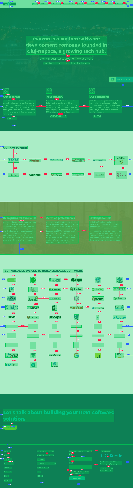
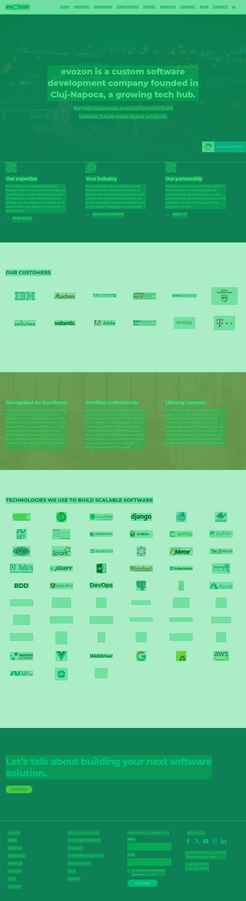

# spacing-measure

Opens a URL, highlights the visible elements, takes a full-page screenshot and
annotates the gap in CSS pixels between each element and its nearest
neighbour above, below, left and right. A second screenshot labels every text
with its font and size.

Screenshots are taken at `deviceScaleFactor: 1`, so 1 screenshot pixel = 1 CSS pixel.

## Setup

    npm install
    npx playwright install chromium
    npm link          # adds the global `measure` command

## Usage

    measure <url> [options]

(`measure` is the same as `node measure.js`; it works from any folder after
`npm link`. Results go to `--out` relative to the folder you run it from.)

| Option       | Default | Meaning                                        |
|--------------|---------|------------------------------------------------|
| `--width`    | 1440    | viewport width (e.g. 390 for mobile)           |
| `--height`   | 900     | viewport height                                |
| `--max-gap`  | 120     | only annotate gaps up to this many px          |
| `--min-gap`  | 1       | hide gaps smaller than this (0 = show touching)|
| `--all`      | off     | draw every gap, without grouping repeats       |
| `--session`  | none    | cookies/localStorage saved with `session.js`   |
| `--wait`     | 0       | extra wait in ms after the page loads          |
| `--wait-for` | none    | CSS selector to wait for before measuring      |
| `--min-size` | 4       | ignore elements smaller than this              |
| `--scope`    | body    | CSS selector: measure only inside this element |
| `--out`      | out     | output folder                                  |

Examples:

    measure <url>
    measure <url> --width 390 --out rezultate/mobil
    measure <url> --scope "footer" --max-gap 80 --min-gap 0
    measure <url> --wait 2000 --wait-for ".product-list" --all

## Pages that need a session (cart, checkout, account)

The measuring browser starts with no cookies, so the cart is empty and you
are logged out. Save a session once, then reuse it:

    node session.js <url>          # browser opens: add to cart / log in, then Enter
    measure <url> --session session.json

`session.json` holds your cookies (including login), so do not share it.

## From a screenshot

When the page cannot be opened (cart, logged-in pages, designs from others),
measure a screenshot instead:

    node measure-image.js captura.png --out rezultate/captura

| Option    | Default | Meaning                                                  |
|-----------|---------|----------------------------------------------------------|
| `--scale` | 1       | screenshot px per CSS px: 2 for retina/200%, 1.25 for 125% |
| `--tol`   | 6       | colour tolerance for "same background" (0-255)           |

Plus `--max-gap`, `--min-gap`, `--min-size`, `--out`, `--all` as above.

Elements are detected from pixels, so this is less exact than `measure.js`:

- text is measured on the visible letters, not on the line-height box;
- a box is a flat, rectangular area of one colour (section, button, card);
- light photos that blend into a white background can be split in pieces;
- buttons and boxes on top of photos are found only if they hold text.

## Output

- `highlighted.png`: page with the measured elements highlighted
- `annotated.png`: same, plus a line and "Npx" label for every gap:
  red = element to its direct neighbour, blue = padding to its container
- `fonts.png`: every text outlined and labelled with its font, size and
  weight, e.g. `Proxima Nova 16px 400` (`measure` only, not `measure-image`)

The console also lists every font/size/weight combination used on the page
and how many texts use it, so stray sizes (e.g. `13px` among `14px`) stand out.

## Fonts

- The font shown is the one Chrome actually rendered (DevTools "Rendered
  Fonts"), not just the first name in CSS `font-family`.
- Orange label, e.g. `Arimo 14px 800 (instead of Jost)`: the CSS font did not
  load and the browser fell back to another one.
- Size is the computed `font-size` in CSS px; weight is `font-weight`
  (400 = regular, 600 = semibold, 700 = bold).
- Repeated texts with the same font are labelled once (`×16`), like the gaps;
  `--all` labels every text. Text hidden with `font-size: 0` is skipped.

## What is measured

- Elements: texts, images, buttons, inputs, icons, plus anything visible only
  through its own background, border or shadow (sections, banners, cards).
- Each element's container is the smallest element that fully contains it.
- In each direction the gap goes to the nearest element in the same container;
  if there is none, it goes to the container's edge (padding).

## Repeated elements

Gaps with the same size, direction and element types on both ends (cards in
a grid, footer links) are drawn once, labelled e.g. `20px ×4`. A different
size (`21px` among `20px`) is drawn separately, so inconsistencies stand out.
Labels never overlap; a gap whose label has no free spot is skipped (the
console says how many).

## Notes

- Text width is the width of the text itself; text height is the line box
  (line-height / content box), the same box DevTools highlights in blue.
- Popups, modals and cookie banners (fixed elements covering >25% of the
  viewport) are hidden before measuring.
- `test/fixture.html` has known gaps (24px, 16px, 84px) for checking accuracy.

### Screenshots

   
